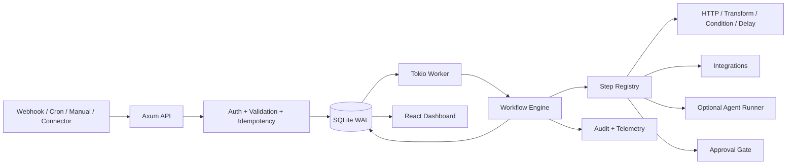

# scaling-waddle — Spécifications fonctionnelles et techniques V1

> **Statut :** spécification cible, à implémenter en TDD  
> **Nature :** plateforme d'automatisation générique, événementielle, open source et self-hosted  
> **Stack :** Rust · React · Vite · shadcn/ui · SQLite · dekit  
> **Principe :** les agents IA sont des exécutants optionnels, pas une dépendance du cœur.

## 1. Vision

**scaling-waddle** permet de définir, déclencher, exécuter, surveiller et auditer des automatisations entre services, applications et outils. Une automatisation peut être entièrement déterministe, utiliser un agent IA pour certaines étapes, ou combiner les deux.

La plateforme s'adresse d'abord aux développeurs et équipes techniques qui souhaitent héberger leurs workflows et garder le contrôle des données, secrets et actions exécutées.

**Pipeline conceptuel :** `Trigger → Workflow → Steps → Actions → Audit`.

### Objectifs

- Connecter des événements (webhooks, planification, déclenchement manuel) à des workflows configurables.
- Exécuter des étapes réutilisables : HTTP, transformations, conditions, délais, scripts restreints, notifications, intégrations et agents IA.
- Assurer persistance, reprise, idempotence, timeouts, retries, historique et observabilité.
- Gérer plusieurs projets/environnements et leurs credentials sans les exposer aux exécutants non autorisés.
- Rester simple à déployer sur une petite infrastructure via Docker Compose.
- Préserver la possibilité d'ajouter des connecteurs et un éditeur visuel sans refondre le moteur.

### Non-objectifs V1

- Remplacer immédiatement n8n, Temporal ou un orchestrateur distribué à grande échelle.
- Fournir un langage de programmation complet dans les définitions de workflows.
- Permettre à un agent IA de modifier librement les règles de sécurité ou d'approuver ses propres actions.
- Offrir un marketplace de plugins, du multi-tenant SaaS public ou une exécution arbitraire non isolée.
- Déployer automatiquement en production ou fusionner des Merge Requests sans validation explicite.

## 2. Cas d'usage

| Déclencheur | Workflow | IA requise ? |
| --- | --- | --- |
| Webhook applicatif | Vérifier le payload, appeler une API, notifier | Non |
| Cron | Collecter des métriques et produire un rapport | Non |
| GitLab pipeline failed | Récupérer les logs, ouvrir une issue | Non |
| GitLab Merge Request | Analyser un diff et rédiger une revue | Oui, optionnelle |
| Uptime Kuma DOWN | Collecter les logs, diagnostiquer, proposer un correctif | Oui, pour diagnostic/correction |
| Sentry error | Enrichir l'événement, créer un ticket | Non |
| Déclenchement manuel | Exécuter une maintenance approuvée | Non |

**AutoFix** est un workflow d'exemple avancé et un futur template, jamais un concept du noyau.

## 3. Principes de conception

1. **Workflow-first :** toute logique métier spécifique appartient aux définitions de workflows ou aux connecteurs.
2. **Event-driven :** l'API ingère rapidement l'événement et délègue l'exécution au worker.
3. **Deterministic core :** planification, transitions, autorisations et politiques sont contrôlées par Rust, pas par un LLM.
4. **Durable execution :** chaque run et chaque étape ont un état persistant et sont récupérables après redémarrage.
5. **Least privilege :** credentials et capacités sont accordés par intégration, workflow et étape.
6. **Composable :** types d'étapes et connecteurs disposent d'interfaces stables.
7. **Human-in-the-loop :** les actions sensibles peuvent nécessiter une approbation.
8. **TDD strict :** Red → Green → Refactor ; tests de contrats aux frontières.

## 4. Périmètre fonctionnel V1

### 4.1 Gestion des workflows

- Créer, éditer, activer, désactiver et versionner un workflow.
- Définir un trigger et une séquence d'étapes avec branchements conditionnels simples.
- Valider la définition avant activation (schéma, références, permissions, cycles interdits).
- Importer/exporter une définition YAML ou JSON.
- Conserver la version exacte utilisée pour chaque run.
- Afficher les workflows et leurs exécutions dans le dashboard.

**V1 :** édition déclarative avec formulaire/éditeur texte validé ; éditeur graphique drag-and-drop hors périmètre initial.

### 4.2 Déclencheurs

- **Webhook générique :** endpoint propre au workflow, secret/signature, validation du corps, clé d'idempotence.
- **Cron :** planification avec fuseau horaire explicite et politique de rattrapage documentée.
- **Manuel :** lancement depuis l'interface ou l'API, avec paramètres validés.
- **Événements externes spécialisés :** GitLab, Uptime Kuma, etc., via adaptateurs qui normalisent les événements vers le modèle commun.

Le trigger produit un **événement normalisé** avec `source`, `type`, `timestamp`, `payload`, `correlation_id`, `idempotency_key` et métadonnées autorisées.

### 4.3 Types d'étapes

| Type | Comportement | V1 |
| --- | --- | --- |
| `http.request` | Appel HTTP sortant avec timeout et auth liée à une intégration | Oui |
| `condition` | Évaluation d'une expression bornée sur les données du run | Oui |
| `transform` | Mapping/extraction déclarative de données | Oui |
| `delay` | Attente persistante jusqu'à une échéance | Oui |
| `notification` | Notification via webhook ou intégration configurée | Oui |
| `approval` | Suspension jusqu'à décision humaine | Oui, version simple |
| `agent.run` | Invocation d'un runner IA isolé | Optionnel, après noyau |
| `script.run` | Script dans sandbox avec permissions explicites | Après noyau |
| `integration.*` | Opération métier exposée par un connecteur | Extension progressive |

Les étapes reçoivent un contexte typé et produisent une sortie structurée, des artefacts éventuels et un statut. Les secrets ne sont jamais injectés dans les sorties persistées.

### 4.4 Exécution et reprise

- Queue persistante SQLite, consommée par un worker Rust.
- États du run : `queued`, `running`, `waiting`, `succeeded`, `failed`, `cancelled`.
- États d'étape : `pending`, `running`, `waiting`, `succeeded`, `failed`, `skipped`, `cancelled`.
- Timeout, politique de retry avec backoff et nombre maximal de tentatives par étape.
- Lease et heartbeat pour récupérer les jobs abandonnés après crash.
- Idempotence à l'ingestion ; les effets externes doivent utiliser des clés d'idempotence quand l'intégration le permet.
- Limites de concurrence globales et par workflow ; une seule instance worker active en V1.
- Annulation coopérative et redémarrage explicite d'un run échoué.
- Conservation de l'historique, avec politique de rétention configurable.

**Garantie :** traitement *at-least-once* en cas de reprise. Ne jamais promettre *exactly-once* pour des effets externes ; concevoir les actions pour être idempotentes ou compensables.

## 5. Modèle de domaine

| Entité | Responsabilité |
| --- | --- |
| `Project` | Regroupement logique de workflows, intégrations et permissions |
| `Workflow` | Identité, métadonnées, statut et version active |
| `WorkflowVersion` | Définition immuable, schéma validé et hash |
| `Trigger` | Configuration d'une source d'événements |
| `Event` | Événement reçu et normalisé, avec clé de déduplication |
| `Run` | Instance d'exécution liée à une version de workflow |
| `StepDefinition` | Configuration déclarative d'une étape |
| `StepRun` | Tentatives, entrées/sorties expurgées, état et durée |
| `Integration` | Connexion à un service et périmètre des capacités |
| `SecretRef` | Référence à un secret, jamais sa valeur dans les définitions |
| `Approval` | Demande, décision et identité de l'approbateur |
| `Artifact` | Référence à un rapport, fichier ou résultat externe |
| `AuditEvent` | Trace append-only d'une action ou transition significative |

Les objets métier d'AutoFix (`Incident`, `Monitor`, `Diagnosis`, `MergeRequest`) appartiennent au template et à ses connecteurs, pas au domaine central.

## 6. Format déclaratif des workflows

Exemple **sans IA** :

```yaml
apiVersion: scaling-waddle.dev/v1
kind: Workflow
metadata:
  name: notify-on-deploy
  project: platform
spec:
  trigger:
    type: webhook
    config:
      auth: signed-secret
  steps:
    - id: check-status
      type: condition
      with:
        expression: 'event.payload.status == "success"'
    - id: notify
      type: http.request
      needs: [check-status]
      if: 'steps.check-status.result == true'
      with:
        integration: team-webhook
        method: POST
        path: /deployments
        body:
          service: '${{ event.payload.service }}'
          version: '${{ event.payload.version }}'
```

**Note :** cette syntaxe est une **proposition de contrat** à figer par tests de parsing et de validation. Les expressions doivent être interprétées par un évaluateur sûr et limité, jamais via `eval` ou shell. La référence `integration` résout un endpoint autorisé et non une URL arbitraire.

## 7. Architecture logique



### Modules backend

- **API :** endpoints REST, réception des triggers, auth, contrôle d'accès, validation, pagination.
- **Application :** commandes, cas d'usage, transactions, gestion des runs et approbations.
- **Domain :** modèles, invariants, machine à états, validation des définitions.
- **Engine :** résolution du graphe, passage de contexte, scheduling des étapes, retry et cancellation.
- **Infrastructure :** SQLite/SQLx, HTTP, chiffrement des secrets, adaptateurs, runner isolé.
- **Worker :** polling de jobs, lease, exécution, reprise et instrumentation.
- **Web :** création/lecture des workflows, exécutions, timeline, intégrations, secrets et approbations.

### Structure de repository

```text
scaling-waddle/
├── Cargo.toml
├── crates/
│   ├── domain/
│   ├── application/
│   ├── engine/
│   ├── infrastructure/
│   ├── api/
│   └── worker/
├── apps/
│   └── web/                 # React + TypeScript + Vite + shadcn/ui
├── migrations/
├── workflows/
│   └── examples/
├── config/
├── docker/
├── docs/
├── dekit.yaml
├── compose.yaml
└── .gitlab-ci.yml
```

L'architecture reste un **monolithe modulaire** avec API et worker comme binaires séparés ; pas de microservices prématurés.

## 8. Stack technique

| Couche | Choix |
| --- | --- |
| Backend API | Rust, Axum, Serde, Tokio |
| Domaine / moteur | Rust, traits pour les ports et handlers |
| Base et jobs | SQLite WAL, SQLx, migrations |
| HTTP sortant | reqwest avec politiques de sécurité |
| Logs / tracing | tracing, tracing-subscriber |
| Frontend | React, TypeScript strict, Vite |
| UI | shadcn/ui, Tailwind CSS |
| Data / routing | TanStack Query, TanStack Router |
| Tests Rust | cargo test, wiremock, SQLite temporaire |
| Tests React | Vitest, Testing Library |
| E2E | Playwright |
| Dev processes | dekit (syntaxe exacte à valider sur la version installée) |
| Production | Docker Compose |
| Agent IA facultatif | Claude Code CLI (`claude -p`) dans sandbox |

`dekit` orchestre uniquement les processus de développement ; la queue métier appartient au moteur et à SQLite.

## 9. API HTTP — proposition V1

| Méthode | Route | Fonction |
| --- | --- | --- |
| `POST` | `/api/v1/triggers/webhook/:token` | Réception d'un événement, réponse `202` |
| `POST` | `/api/v1/workflows/:id/runs` | Déclenchement manuel |
| `GET` | `/api/v1/workflows` | Liste des workflows |
| `POST` | `/api/v1/workflows` | Création |
| `GET` | `/api/v1/workflows/:id` | Détail et versions |
| `POST` | `/api/v1/workflows/:id/versions` | Nouvelle version |
| `POST` | `/api/v1/workflows/:id/activate` | Activation d'une version |
| `GET` | `/api/v1/runs` | Liste filtrable |
| `GET` | `/api/v1/runs/:id` | Détail, étapes, timeline |
| `POST` | `/api/v1/runs/:id/cancel` | Annulation |
| `POST` | `/api/v1/runs/:id/retry` | Nouvelle tentative contrôlée |
| `GET` | `/api/v1/integrations` | Intégrations configurées |
| `POST` | `/api/v1/approvals/:id/decision` | Approbation ou refus |
| `GET` | `/health/live` | Liveness |
| `GET` | `/health/ready` | Readiness |

La gestion des credentials, des projets et des utilisateurs nécessite des routes authentifiées supplémentaires. Les tokens de webhook sont opaques, stockés sous forme de hash et révocables.

## 10. Frontend et UX

### Écrans V1

1. **Overview :** activité récente, runs réussis/échoués, workflows actifs, alertes.
2. **Workflows :** liste, activation, versions, définition YAML/JSON, validation.
3. **Workflow detail :** trigger, étapes, configuration, historique des runs.
4. **Runs :** filtres, statut, timeline, tentatives, durées, erreurs et artefacts.
5. **Integrations :** connexions, permissions, tests de connectivité, secrets masqués.
6. **Approvals :** demandes en attente et décisions historisées.
7. **Settings :** projets, rétention, limites et utilisateurs administrateurs.

**UX V1 :** privilégier une interface claire et opérationnelle. Pas d'éditeur visuel de graphes obligatoire ; une représentation en lecture seule des étapes est envisageable.

## 11. Sécurité

- Authentification du dashboard et de l'API d'administration ; rôles minimaux `admin`, `operator`, `viewer` (permissions détaillées à figer).
- Vérification des signatures webhook, protection anti-rejeu et rate limiting.
- Secrets chiffrés au repos avec clé maître externe à SQLite ; références de secrets dans les workflows.
- Journaux, sorties d'étapes et erreurs expurgés des secrets et données sensibles.
- HTTP sortant contrôlé contre le SSRF : destinations autorisées, validation DNS/IP, refus des réseaux internes par défaut sauf exceptions explicites.
- Scripts et agents dans un environnement isolé, avec limites CPU/mémoire/temps, filesystem temporaire et accès réseau restreint.
- Aucun accès direct au socket Docker de l'hôte depuis un runner IA ou script non fiable.
- Approbation humaine pour les actions à impact élevé ; audit de l'identité, du moment et de la décision.
- Contrôles des payloads et des artefacts (taille, type, rétention).
- Isolation logique par projet ; les intégrations ne sont pas implicitement accessibles à tous les workflows.

### Cas Claude Code

Le runner Claude Code est **facultatif**. Il est appelé en mode non interactif dans une sandbox dédiée et ne reçoit que les ressources nécessaires à l'étape. L'authentification via abonnement Claude Code, ses limites et les conditions d'utilisation doivent être vérifiées avant déploiement ; ne pas supposer que tous les scénarios d'automatisation headless sont autorisés ou illimités. Aucun secret GitLab de publication n'est confié directement au modèle.

## 12. Observabilité et exploitation

- Logs structurés avec `project_id`, `workflow_id`, `run_id`, `step_id`, `correlation_id`.
- Mesures : runs/minute, latence par étape, taux d'échec, profondeur de queue, retries, approvals en attente.
- Historique d'exécution lisible dans le dashboard ; distinction entre erreurs techniques et erreurs fonctionnelles.
- Endpoint de santé et logs Docker Compose.
- Rotation/rétention des données et sauvegarde SQLite cohérente (base + WAL via mécanisme adapté).
- Politique de surcharge : quotas de concurrence, taille des événements, circuit breaker par intégration.

## 13. Qualité et stratégie TDD

**Règle :** chaque comportement métier commence par un test qui échoue, puis implémentation minimale, puis refactorisation.

### Backend

- Tests unitaires des états, invariants, validation et évaluation des conditions.
- Tests de persistance SQLx sur SQLite temporaire : migrations, transactions, idempotence, lease, reprise.
- Tests de contrats des adaptateurs via wiremock.
- Tests d'intégration Axum : auth, webhook, `202`, erreurs et rate limits.
- Tests de reprise : crash simulé, retry, timeout, duplicate event, approbation refusée.

### Frontend

- Vitest + Testing Library : formulaires, validations, listes, filtres, timelines, permissions.
- Playwright : créer/activer un workflow, déclencher, inspecter un run, approuver/refuser.

### CI

`cargo fmt --check`, `cargo clippy -- -D warnings`, `cargo test`, `pnpm lint`, `pnpm typecheck`, `pnpm test`, build frontend, E2E ciblés. Ne pas dépendre de services SaaS ou d'un compte Claude pour la suite de tests principale.

## 14. Roadmap incrémentale

### M0 — Socle

- Workspace Rust, API Axum, worker Tokio, app React/Vite/shadcn/ui.
- SQLite + migrations, tracing, Docker Compose, dekit, CI et harness de tests.
- Auth admin minimale et healthchecks.

**Acceptation :** stack démarrable localement, tests verts, aucune logique spécifique à AutoFix.

### M1 — Moteur déterministe

- Modèle `WorkflowVersion`, `Event`, `Run`, `StepRun`.
- Webhook générique, déclenchement manuel, idempotence, queue persistante.
- Étapes `condition`, `transform`, `http.request` ; retries et timeouts.
- Dashboard workflows et runs.

**Acceptation :** un webhook déclenche un workflow HTTP sans IA ; un redémarrage du worker ne perd pas les runs.

### M2 — Orchestration opérationnelle

- Cron, `delay` persistant, approvals, annulation, limites de concurrence.
- Gestion des intégrations et secrets, permissions, audit et rétention.
- Import/export et versioning complet des définitions.

**Acceptation :** workflows multi-étapes avec branches simples, approbation et reprise après crash.

### M3 — Connecteurs et agents optionnels

- Premier connecteur métier (GitLab ou Uptime Kuma).
- Interface `AgentRunner` et implémentation Claude Code CLI isolée.
- Exemple AutoFix sous forme de workflow/template, avec contrôle humain obligatoire avant publication sensible.

**Acceptation :** les workflows sans IA restent entièrement fonctionnels quand aucun runner IA n'est configuré.

### M4 — Évolutions post-V1

- Éditeur visuel, connecteurs additionnels, exécution distribuée, workflows réutilisables, versioning/rollback avancés, RBAC plus fin, moteur de scripts renforcé.

## 15. Décisions structurantes

| Sujet | Décision |
| --- | --- |
| Nom du repository et de la plateforme | **scaling-waddle** |
| Produit | Automatisation généraliste, non centrée sur l'IA |
| Unité fonctionnelle | Workflow versionné |
| Unité d'exécution | Run persistant et étapes traçables |
| Architecture | Monolithe modulaire Rust ; API et worker séparés |
| Frontend | React + Vite + shadcn/ui |
| Persistance initiale | SQLite WAL + SQLx |
| Déploiement | Self-hosted, Docker Compose |
| Développement local | dekit |
| Qualité | TDD strict |
| IA | Runner facultatif, isolé, interchangeable |
| AutoFix | Workflow/template d'exemple, pas domaine central |
| Actions sensibles | Approbation et audit, pas d'autonomie illimitée |

## 16. Points à préciser avant implémentation

1. **Modèle de workflow :** liste linéaire avec conditions en V1, ou DAG complet dès le départ ? Recommandation : étapes ordonnées + branchements simples, avec validation permettant une extension vers DAG.
2. **Auth :** administrateur local unique pour M0, puis utilisateurs/rôles ; définir la stratégie de session.
3. **Expressions :** choisir un moteur d'expressions sûr et en figer les limites par tests.
4. **Secrets :** sélectionner une solution de chiffrement et une stratégie de rotation/récupération de clé.
5. **Connecteurs :** commencer par HTTP/webhook génériques ; ajouter des adaptateurs spécialisés selon les workflows prioritaires.
6. **Agent runner :** valider les conditions d'usage de Claude Code CLI et son mode d'isolation avant intégration.
7. **Licensing :** choisir la licence open source et la politique de contribution.

---

**Résumé :** `scaling-waddle` est un moteur d'automatisation self-hosted qui transforme des événements en workflows fiables et auditables. L'IA, GitLab, Docker et AutoFix sont des extensions possibles ; aucun n'est nécessaire pour faire fonctionner le cœur de la plateforme.
